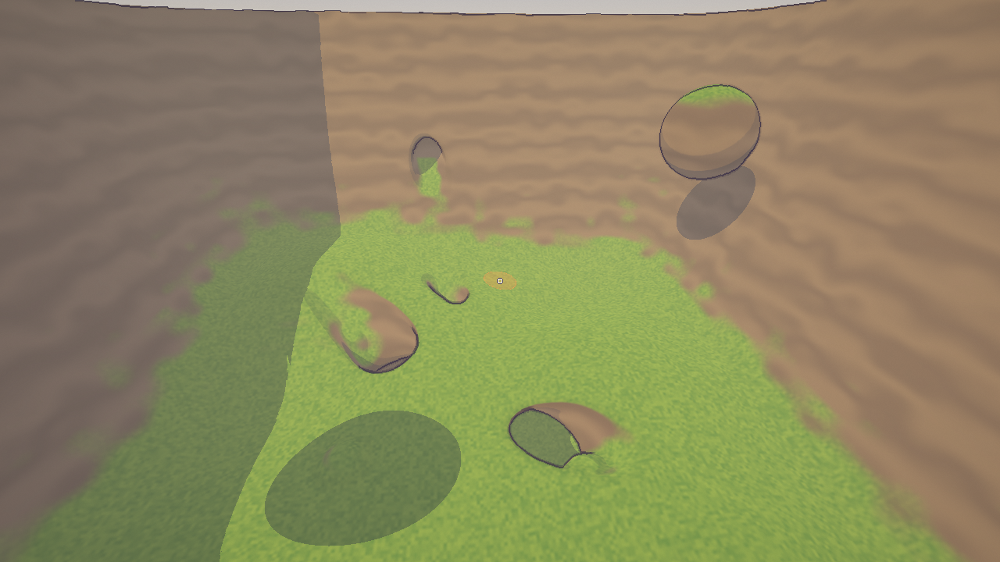
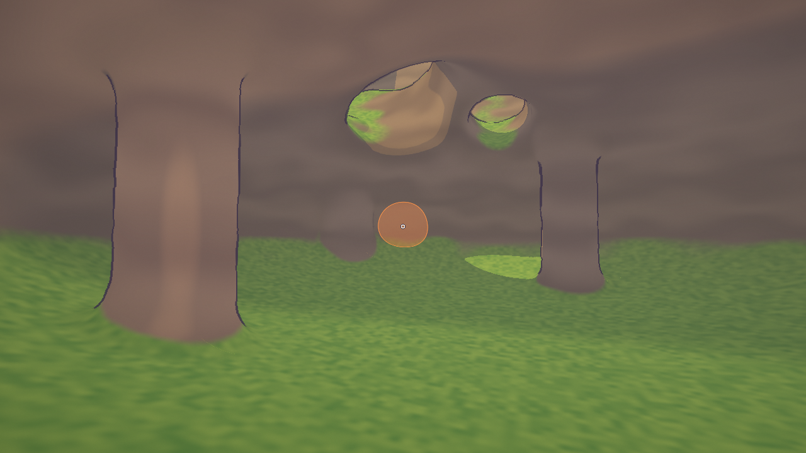
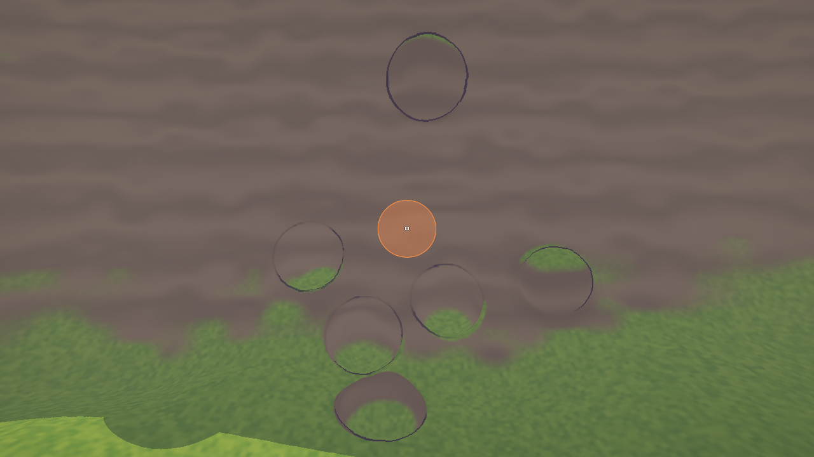
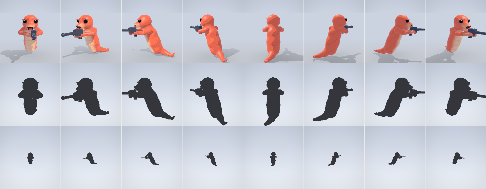
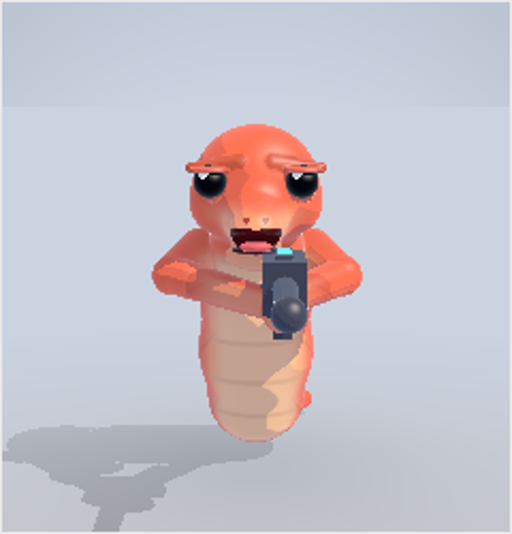
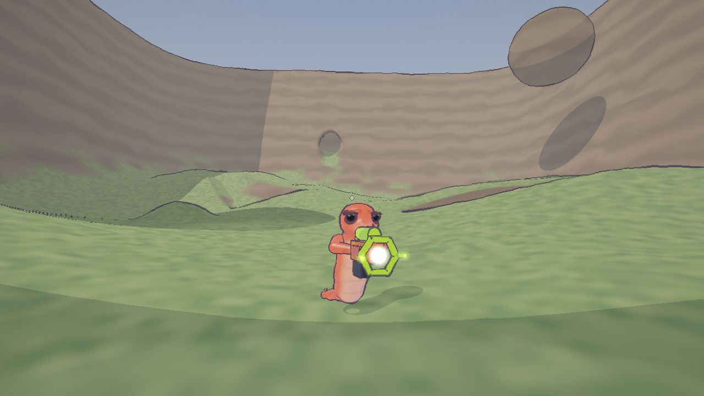

# 3D SDF Liero (working title)

A real-time 3D worm shooter in the spirit of *Liero*, on **fully destructible,
formable terrain stored as a signed distance field (SDF)**. Rust, wgpu, no
external assets. Cel shaded, with Okami-like ink outlines. Smooth, fast
gameplay beats graphics. 

It is also a learning project: the code is commented to explain *why*, names the
patterns from *Game Programming Patterns* where they are used, and will explain
the networking concepts where they appear.

**Where it is:** milestone M3 of seven. You play a worm in a cave-and-hills
world: walk, jump, dig tunnels and swing on a ninja rope, at 60 fps on an
integrated laptop GPU, and now fight: twelve weapons (rockets, a railgun, bombs,
homing swarms, a teleport gun, a Nova that charges for a beat and then clears a
cavern, a plasma whip whose lash is a rope that hangs from the hand and lashes across
a wide arc, alternating left and right and cutting a thin slit into the rock,
before it smashes down after a double jump, a wall-thrower and a forming beam). Explosions carve the terrain,
rock is cover, and a dead worm comes back
after three seconds. Guns are oversized and kick; a lobbed shell draws a dotted
arc to the point it will land on, a ricochet marks its first bounce, and a big
blast shows its footprint, while rockets leave smoke in the air. Every weapon
also has its own synthesised voice: a dry blaster tick, a rocket thump, a
railgun crack with a ringing tail, and a cavern-sized Nova. The same weapon id
shapes the picture too: a rocket blooms orange, a bomb throws dirt under a long
dark cloud, and a Nova is ice-white with a shockwave; hits spark in the weapon's
colour and shake the camera by its weight. The Cluster is a real mortar: its
barrel points up and every shell leaves on a lofted arc, even aiming level.
Hits are loud in the Liero sense:
the victim flashes white and flinches, blood arcs out and stains the rock, and
a wounded worm carries a five-pip health bar over its head. Blasts and taking a
hit flash the whole frame white for a blink, with a slight chromatic split. The
world is graded a third towards grey by default, so the guns, blood droplets and
health pips are the only strong colour on screen (`C` A/Bs the grade). Blood that
lands is a painted decal: it reads the G-buffer surface, so it follows the rock
instead of floating over it, and the map keeps thousands of marks for minutes.
Sounds are panned
and muffled by distance. The rules run in a pure `sim` crate, with headless tests.
There is no multiplayer yet (M4-M6, see [PLAN.md](PLAN.md)). The second worm is
an idle dummy to practise on. The M1 fly camera and brush are still there (press F).

| | |
|---|---|
|  |  |
| *The arena. Craters and the raised blob were made with the brush.* | *Inside the cavern, lit by a warm headlamp where the sun does not reach.* |



*Craters in a mountain flank. The orange disc is the brush.*

### The worm

The body is one signed distance field: a tapered spine, a head with a snout,
sockets, a cut grin, a curling tail and two arms holding the gun. There are no
seams between parts, so it gets one ink outline and the belly is painted as a
material instead of being a second capsule stuck to the chest. The development
sheet renders eight yaws at gameplay size, then the same silhouettes at 60 px.
The sheet and the game compile the same `WORM_SCULPT` chunk, so the preview
cannot drift from the body that ships.

| | |
|---|---|
|  |  |
| *The body sheet used to tune the sculpt.* | *Grumpy brows, lidded bead eyes, cut grin.* |



*In the game: the same SDF body, with the existing guns, health bar, hit flash and ink outline.*

## Run it

You need Rust (stable) and a GPU with a DX12, Vulkan or Metal driver.

```
cargo run -p viewer --release
```

Click the window to capture the mouse; Esc releases it, Esc again quits.

| Input | Does |
|---|---|
| W A S D, mouse | run (the body turns; the mouse aims), look |
| Space | jump (hold for height); press again in mid-air to double jump |
| hold W into a wall | climb it; S climbs down; Space kicks off the wall. Low ledges and crater rims (up to ~1 m) are climbed automatically, and a jump that reaches a higher lip grabs it |
| left mouse (hold) | fire the current weapon |
| 1 2 3 4 5 6 7 8 9 0 - =, mouse wheel | pick a weapon: Blaster, Rocket, Railgun, Bouncer, Bomb, Cluster, Swarm, Teleport, Nova, Block, Tractor, Plasma Whip |
| Left Shift (hold) | dig: a smooth 3 m tunnel where you look (up to 4 m away), five bites a second |
| right mouse | shoot the ninja rope at what you look at; press again to let go |
| E / Q | reel the rope in / out. Reeling in *pulls* you (up to 20 m/s), so you can launch yourself out of a hole |
| Space on the rope | let go with an upward kick |
| W A S D on the rope | pump the swing: steering adds speed up to 24 m/s |
| F | switch to the M1 fly camera and brush (below) |
| *fly mode:* W A S D, Space / Ctrl, Shift | fly, up / down, fast |
| *fly mode:* left / right mouse (hold) | carve / build with the brush (build blends in like clay) |
| *fly mode:* mouse wheel | brush radius |
| F1 / F2 / F3 | fixed render resolution 100% / 75% / 50% |
| T | automatic resolution (default): scales the resolution to hold ~60 fps |
| G / H / O / V | shadows / ambient occlusion / ink outlines / vsync |
| M | mute / unmute the sound |
| R | regenerate the map (about half a second) |

The HUD (`viewer/src/hud.rs`, design in `mockups/hud_mockup_v5.html`) shows health,
kills and deaths, the weapon with its slot rail, magazine and ready / reloading /
charging state, and a hit marker on the reticle. The window title keeps the debug
numbers: fps, GPU milliseconds per pass, the sim, edit and upload cost, the brush
size, the render scale and whether sound is on.

Headless modes (no window needed):

```
cargo run -p viewer --release -- --shot out.png --edits --cam 62,36,54,180,-12
cargo run -p viewer --release -- --shot out.png --worm 64,38,200 --cam 64,19.5,32,0,-0.12
cargo run -p viewer --release -- --shot out.png --worm 64,38,0 --cam 56,24,24,32,-14 --fire 1,50
cargo run -p viewer --release -- --shot out.png --worm 64,38,0 --cam 66.5,19.4,41,226,-11 --weapon 8
cargo run -p viewer --release -- --shot out.png --worm 64,38,0 --cam 58,19,30,56,-10 --boom 4,74,18,36,20
cargo run -p viewer --release -- --shot out.png --worm 64,38,0 --cam 58,19,30,56,-10 --hurt 34
cargo run -p viewer --release -- --shot out.png --worm 64,38,0 --cam 58,19,30,56,-10 --hurt 34 --flash 0.6
cargo run -p viewer --release -- --bench --size 1920x1080
cargo test -p sdf -p sim -p viewer
```

`--fire id[,ticks]` fires that weapon and takes the picture `ticks` later (so
projectiles and blasts are in the air); `--weapon id` just holds it, with no
shot, which is the way to look at a gun. The Nova's wind-up takes 72 ticks and
a whip swing lasts 18, so `--fire 8,40` catches the Nova charging, `--fire 8,110`
catches the blast, and `--fire 11,9` catches the whip halfway through its swing.

`--no-brush` hides the orange dig ring that otherwise sits on the terrain behind
the character, and `--no-aim` hides the weapon aim aid: lobbed arcs, blast rings
and ricochet marks. `--hurt damage` wounds the worm first, so one PNG shows the
blood spray, the hurt flash and the health bar without needing a second player.
`--flash 0..1` previews the post-process impact flash, and `--no-grade` turns off
the world desaturation (the same A/B as the `C` key).

`--boom weapon,x,y,z[,ticks]` carves a blast at that point and takes the picture
`ticks` later (default 10), so one exact camera can inspect an explosion without
hunting for one in play.

On Windows the viewer uses DX12 because Vulkan crashed on the Intel driver it was
developed on. Set `WGPU_BACKEND=vulkan` (or `metal`, `gl`) to override.

### Build a standalone copy to send to someone

The viewer needs no asset files: shaders, sound and the world are in code, so a
build is one exe. Link the C runtime statically, or the exe also needs the VC++
runtime (`VCRUNTIME140.dll`), which a clean Windows may not have:

```
$env:RUSTFLAGS='-C target-feature=+crt-static'
cargo build -p viewer --release --target-dir target\standalone
```

Send `target\standalone\release\viewer.exe`. It is a 64-bit Windows build and
needs a DX12 driver, like the normal build. The separate target directory keeps
it apart from `target\release`, so `cargo run` is unaffected. Because the exe is
unsigned, Windows SmartScreen will ask before running it.

## How it works

The terrain is a grid of distances to the nearest surface: positive in air,
negative in rock, zero on the surface, one signed byte per 0.25 m voxel, in
16-voxel chunks (a 128 x 64 x 128 m world is 64 MB). Digging is
`max(terrain, -shape)`, building is `min(terrain, shape)` or a smooth minimum,
so an edit is a tiny value (a shape and an operation), which is also what will go
over the network.

* **[`sdf/`](sdf/)** is a pure crate (no window, GPU, clock or I/O): the grid,
  edits, `sample` / `gradient` / `raycast` for collision, parallel map
  generation, dirty-chunk tracking, checksums. Collision will sample the grid
  directly; there is no collision mesh.
* **[`sim/`](sim/)** is the game's rules, also pure (no window, GPU or clock).
  `World::step(&[Input])` is the only way state changes. A worm is a capsule
  tested as three spheres against the distance field: push out along the
  gradient, run and turn with momentum (the body faces the run, the mouse
  aims), jump and double jump in mid-air (a jump adds height, never speed),
  climb walls, wall-kick, dig, and swing on a rope. Weapons are rows of
  a table (`weapons.rs`); `combat.rs` is
  the few rules that read it: projectiles
  that step through the distance field, explosions that carve it, damage with
  rock as cover, respawning. Read `movement.rs`, `world.rs` and `combat.rs`;
  their tests are the specification.
* **[`viewer/`](viewer/)** copies the grid into a 3D
  texture and **raymarches it on the GPU** (sphere tracing), shades it with a
  three-band toon ramp, and draws ink outlines from a depth/normal buffer.
  After an edit only the changed chunks are re-uploaded. Worms are rigs of
  analytic capsules (segmented body, tail, eyes, arms and gun) found by a
  closed-form ray test inside the same shader, so they get shadows, AO and
  outlines for free; the rig undulates, leans, flips and squashes from the sim's
  action and velocity. Projectiles and the fireballs the sim's events start are
  capsules too. The camera sits over the worm's shoulder, so the worm never
  covers the crosshair; the sim is told to aim from the eye at the point under
  the reticle, which keeps shots and the rope on target despite the offset.
  Digging instead goes straight out of the worm's face along the look angles:
  the crosshair ray is a shoulder to the side, and a tunnel centred there would
  be one the worm could not walk into.
  It runs the sim at a fixed 60 Hz and
  draws between ticks. Read it in this order: `main.rs` (window, input, game
  loop), `worms.rs`, `effects.rs`, `audio.rs` (the synth and the event-driven
  mix), `renderer.rs` (textures, passes, uploads, GPU timers), `shaders.rs` (the
  WGSL), `world.rs` (the demo map), `camera.rs`.

Why raymarch instead of meshing the terrain? The first plan used Surface Nets
meshes. At 0.25 m voxels a mesh looks faceted, and toon bands plus outlines make
facets show. The author of the video that inspired this project raymarches baked
SDF bricks, so M1 does too. Details and what could not be confirmed are in
[PLAN.md](PLAN.md).

## Performance

On an Intel UHD laptop GPU at 1280 x 720 the frame went from roughly 37-67 ms to
18-23 ms at full resolution (the early numbers are less precise, see the log), edit uploads from 23 ms to 2-4 ms, and map generation from
19.5 s to 0.6 s. Everything on, it holds 60 fps at about 65% internal
resolution (automatic).

The full log is in **[docs/PERFORMANCE.md](docs/PERFORMANCE.md)**: every
bottleneck found (too many texture fetches per pixel, shadow rays, per-chunk
uploads, an outline pass that ignored the render scale, a 19.5 s map generator,
high-DPI scaling), each optimisation with before/after numbers, what did not
help, how noisy the measurements are on this laptop, and what to try
next.

## Roadmap

Milestones (full detail and decisions in [PLAN.md](PLAN.md)):

| | |
|---|---|
| M0 | `sdf` crate and terrain spike: **done** |
| M1 | Raymarched viewer with brush editing: **done** |
| M2 | A worm in the sim: capsule against the SDF, jump, dig, rope, aim: **done** |
| M3 | Weapons as data rows: explosions carve, build adds, tractor beam: **built, awaiting review** |
| M4 | Host + loopback + replica: offline play through the same pipeline as online |
| M5 | Online: relay server, late join, edit events, checksums |
| M6 | Polish: bots, procedural maps, HUD, audio polish |

## Repository

| Path | What |
|---|---|
| `sdf/`, `sim/`, `viewer/` | the 3D code (in the workspace) |
| `sim/old2d/` | the 2D game's bots, kept to be ported at M6 (its weapons and world were ported at M3 and deleted; they stay in git history) |
| `protocol/`, `host/`, `server/`, `game/src/{share,local,join,net,socket}.rs` | the 2D game's networking and relay, kept to be ported at M4-M5; they do not compile yet |
| [`PLAN.md`](PLAN.md), [`CLAUDE.md`](CLAUDE.md) | the plan and decisions; the working rules for the code |
| [`docs/PERFORMANCE.md`](docs/PERFORMANCE.md) | performance log |
| [`docs/WEAPON_FEEL.md`](docs/WEAPON_FEEL.md) | design spec: making each weapon feel powerful (per-weapon signatures, the work order) |
| [`docs/NETWORKING.md`](docs/NETWORKING.md), [`docs/DEPLOY.md`](docs/DEPLOY.md) | written for the 2D game's relay; they apply again from M5 |
| [`docs/PLAN_2D.md`](docs/PLAN_2D.md) | the 2D game's plan |
| `screenshots/` | screenshots used above |

This project began as a fork of **Bomblero**, a 2D neon-cave arena shooter
(macroquad, browser and native, online through a relay). Its history is kept: the
2D game is in the git history from before the fork's changes.

## License

MIT, see [LICENSE](LICENSE).
